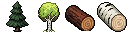

# Art direction

IdleHold uses a hybrid style: **pixel art for world objects** (trade emblems, frames,
action sprites, items) and for the **board** the screen is built on (the plank wall and the
wooden panel frames), inside a clean "Guild Signboards" UI (see `DESIGN.md`). Buttons and
frames may be pixel art too, as 9-slice images around an HTML label; text and bars never are.

## The style base

The base of the art is the current set of tree and log sprites. Every new sprite must
look like it belongs next to them.

`art/style-reference.png` (128x32) holds, left to right: pine tree, birch tree, pine log,
birch log. It is the style image passed to every generation.

What defines the style:

- **32x32 grid** for every sprite. Frames are the only exception: they wrap a 32x32 opening.
- **Dark single-colour outline**, about one pixel, around the whole silhouette.
- **Soft, painterly shading** with a few tones per material; light from the top left.
- **Muted, earthy colours**: dark greens, warm browns, off-white birch bark. No neon or
  saturated primaries.
- **"A little detailed, not very detailed"**: readable at 1x, with texture (bark, rings,
  needles) but no noise.
- **Transparent background**, the subject centred and filling most of the canvas.
- Objects sit at a slight three-quarter angle; logs lie on their side with the cut end
  facing the viewer.

## How to generate

Tool: PixelLab, `create_image_pro` (one call returns 64 candidates at 32x32 for
10 generations).

- `style_image`: `art/style-reference.png` (upload it with `get_upload_url`).
- `width` / `height`: 32 (frames: 48, then cropped to fit a 32x32 opening).
- `no_background`: true.
- Prompt: name the single subject and its materials, then the role, e.g.
  `a single short oak log lying on its side, ... medieval game inventory item icon`.
  Ask for "not too detailed" when the subject is a low tier.
- For a subject similar to an existing sprite (another fish, another ore), pass the
  approved sprite in `reference_images` with a usage note for pose, orientation and scale.
- Ask for the size explicitly when a subject is long ("about 28 pixels long so it fits
  the canvas"), so it is not drawn past the edges.
- Review candidates with `art/tools/contact-sheet.ps1`, which downloads them into the
  ignored `art/candidates/` folder and builds a numbered sheet. PixelLab sometimes slices its
  candidate sheet off the real grid (by 13 to 16 px), so a raw download holds half of one drawing
  and half of the next. The script lays the raw downloads back into the sheet, finds the real grid
  lines (the emptiest columns and rows) and re-cuts every candidate there. Never repair a cut
  candidate by gluing its halves: they come from two different drawings and leave a seam.
- Before picking, look at the shortlist zoomed in (6x or more) and reject anything with a seam,
  a broken outline or a missing part. A subject may touch the canvas edge only when nothing was
  painted just past it.
- Pick the candidate that matches the base best, keep its orientation consistent with
  siblings (for example, every log's cut end on the same side), and record the prompt and
  candidate index in the table below.

## Using sprites in the client

- Files live in `web/src/assets/<kind>/`: `emblems/`, `frames/`, `actions/`, `items/`, `brand/`, `menu/`.
- Render them with `PixelSprite` (`web/src/components/PixelSprite.tsx`): whole-number
  scale only (1x, 2x, 3x) and `image-rendering: pixelated`, so pixels never smear.
- Sprites are decorative (`alt=""`); the name next to them carries the meaning.
- Trade emblems sit in a frame (`TradeEmblem`) over the dark `frame-well` backing. Wood is
  the first frame tier; later tiers (stone, gold, ...) reuse the same 46x48 shape with a
  32x32 opening at (7, 8), so they swap in without layout changes.

## The board

The screen is a notice board (`web/src/assets/board/`, used from `web/src/index.css`):

- **Planks** (`board/planks.png`, 116x59): a seamless tile drawn at 3x. Generated with
  `create_image_pro` at 64x64 on an opaque background. No candidate tiled cleanly (each had an
  outline around the canvas), so the chosen one was made seamless by hand: the outline cropped
  off, the crop placed next to its mirror image (so the left and right edges meet), each plank
  row rolled by a different amount, and one board end (a dark joint) cut into each row, so the
  board ends stagger like real planks.
- **Frame** (`board/frame.png`, 58x58): a wooden frame with iron corner brackets, used as a CSS
  `border-image` 9-slice with 18-pixel slices (1x on phones, 2x from tablets up): the corners stay
  fixed and the plain edges repeat. The candidate was cropped to its drawing, and the outline of the
  plain edges was carried out to the image edge, where the corners overhang by one pixel; otherwise
  the panel's own wood shows through a thin gap between the frame and the wall.
- **The wall** is the planks under a 45% black veil, so it recedes; the framed panels show the same
  planks undimmed and cast a soft shadow on it.

## Village scene

The village is the game's hub, seen in first person from the camp, looking out to the horizon
(`web/src/features/village/`). It uses bigger pixels than the item sprites: the scene is 320x180 art
pixels, scaled to the width of the middle column; the space below it holds information blocks.
Three layers, placed in art pixels:

- **Sky** (`village/sky.png`, 384x64): drifts left one art pixel per step in a seamless loop. Generated
  with `create_image_pro`, locked to the six colours of the scene's own sky, then made seamless by
  rolling it half its width and inpainting the join.
- **Scene** (`village/scene.png`, 320x180): the approved sketch ("sketch A": `create_image_pro` with the
  project owner's reference for composition, then `edit_image` for crisper, more detailed props), with
  every sky pixel cut out so the drifting sky shows behind the trees and hills.
- **Campfire**: two pieces that brighten together on hover.
  - `village/campfire.png` (41x32): the stone ring and flames cut out of the scene pixel for pixel, so
    it sits over the painted fire unchanged until the pointer is on it. Cut with a mask: the span between
    the ring's dark outline on each row, plus the flame-coloured pixels above it.
  - `village/fire.png` (8 frames of 64x96): `animate_image` on a crop of the fire and its smoke; each
    frame keeps only the pixels that change.

Motion stops for players who ask for reduced motion. Each piece that reacts to the pointer is cut out
the same way (an exact copy of its pixels, so no repainting), with a hit shape that follows its outline;
it becomes a button once clicking it does something, and changes art as it is rebuilt.

## Buttons and tool frames

- **Wooden button** (`frames/wood-button.png`, 54x13): one nailed plank, used by `.wood-button` as a
  9-slice at 3x (4-pixel top and bottom, 9-pixel ends that hold the nails), so it fits any label.
  Hover brightens it, pressing moves it down a pixel, and disabled greys it.
- **Iron frame** (`frames/iron.png`, 38x38): wrought iron with corner pieces and a 24x24 opening,
  used as a 9-slice with 8-pixel corners: `.iron-frame` at 2x around a tool (a 32x32 sprite at 2x).
  The dark well behind it stays inside the band (`background-clip: padding-box`). Material slots
  are plain squares with a thin black border, so the tool stays the one framed thing on the card.
- **Menu plaque** (`frames/menu-plaque.png`, 56x20): a wine-red plaque with a gold trim and gold
  corner blocks, the red and gold of the tower's banner. Used by `.menu-plaque` at 3x and its native
  height (4-pixel top and bottom, 9-pixel left and 10-pixel right ends); the trim between the
  corners tiles. The generated plaques came with an empty middle, so the red face was flood-filled
  with the rail sign's red (`#65212e`).
- **Profile plate** (`frames/profile-plate.png`, 61x30): the menu's gold trim and corner blocks on a
  navy face, so the profile reads apart from the menu entries. Used by `.profile-plate` at 2x
  (13-pixel top and bottom, 15-pixel ends); the trim between the corners tiles, so it grows with
  what it holds.

## Asset log

| File | Prompt (short) | Notes |
| --- | --- | --- |
| `actions/pine-tree.png` | a whole pine tree, tall evergreen conifer, short brown trunk | Style base |
| `actions/birch-tree.png` | a whole birch tree, slender white trunk with black markings, rounded light green crown | Style base |
| `items/pine-log.png` | a single short pine log lying on its side, cut end with rings facing the viewer | Style base |
| `items/birch-log.png` | a single short birch log lying on its side, cut end with pale rings facing the viewer | Style base |
| `emblems/woodcutting.png` | a medieval iron hatchet leaning diagonally against a short chopped log | Woodcutting emblem |
| `frames/wood.png` | simple square wooden frame, plain planks, nails at the corners, not too detailed | First frame tier; stretched pixel-exact from 37x38 to 46x48 |
| `emblems/fishing.png` | a medieval wooden fishing rod with a line, leaning diagonally against a small woven wicker fish basket | Candidate 42; Woodcutting emblem as composition reference |
| `emblems/mining.png` | a medieval iron pickaxe with a wooden handle, leaning diagonally against a small grey rock | Candidate 63; Woodcutting emblem as composition reference |
| `actions/perch.png` | a small perch fish leaping out of a little patch of dark blue water with ripples | Candidate 33 |
| `actions/pike.png` | a long slender pike leaping in a gentle arc out of a small patch of dark blue water, whole subject inside the canvas | Candidate 47; `actions/perch.png` as composition reference |
| `actions/stone.png` | a grey stone boulder outcrop with cracks and a little moss at the base | Candidate 31 |
| `actions/copper.png` | a dark grey rock outcrop with chunks of orange-brown copper ore showing through | Candidate 7 |
| `items/perch.png` | a single raw perch lying on its side, head facing left, dark vertical stripes, orange fin | Candidate 4 |
| `items/pike.png` | a small raw pike lying straight and horizontal, head facing left, about 28 px long to fit the canvas | Candidate 8 |
| `items/stone.png` | a single rough-cut grey stone block, chiselled building stone | Candidate 17 |
| `items/copper-ore.png` | a single lump of raw copper ore, dark grey rock with orange-brown and green-tinted chunks | Candidate 8 |
| `items/twig.png` | a small bundle of a few thin dry brown twigs tied with a plant fibre band, about 26 px long | Candidate 47 of a second run; `items/pine-log.png` as reference. The first run drew a bundle too long for the canvas |
| `items/pebble.png` | a few small smooth grey pebbles in a little cluster, rounded river stones | Candidate 4; `items/stone.png` as colour reference |
| `items/wild-berry.png` | a small cluster of dark purple-red wild berries with two green leaves on a short stem | Candidate 8 (realigned) |
| `actions/twigs.png` | fallen dry twigs and small broken branches on a little patch of grass and dirt | Candidate 17 (realigned); `actions/stone.png` as composition reference |
| `actions/pebbles.png` | a few small loose grey pebbles on a little oval patch of grass and dirt | Candidate 2; the twigs action for the ground patch, `items/stone.png` for colour |
| `actions/berry-bush.png` | a small round wild berry bush, dark green leaves dotted with dark purple-red berries | Candidate 3 (realigned); `actions/stone.png` as composition reference |
| `board/planks.png` | seamless tileable texture of weathered horizontal wooden planks, a medieval village notice board, warm medium-dark brown wood | Candidate 6, made seamless by hand (see The board) |
| `board/frame.png` | a plain square wooden picture frame made of thick dark brown planks, small iron nails at the four corners | Candidate 9 (iron corner brackets); `frames/wood.png` as reference; edge outline extended |
| `emblems/crafting.png` | a medieval wooden mallet and a small iron chisel crossed diagonally, leaning against a short wooden workbench stump | Candidate 0; `emblems/woodcutting.png` as composition reference |
| `items/chipped-stone-axe.png` | a single chipped stone hand axe: a short stick handle with a knapped grey flint head lashed on with plant fibre cord | Candidate 41; `items/twig.png` for wood and cord colour. Also the recipe's action sprite |
| `items/reed-fishing-rod.png` | a simple primitive fishing rod: a thin bare wooden pole, a pale twisted reed line and a small bone hook, about 30 px long | Candidate 15; `items/twig.png` as reference. Also the recipe's action sprite |
| `items/reed.png` | a small bundle of long pale green and straw-yellow reed stalks tied in the middle, about 26 px long | Candidate 3; `items/twig.png` for the bundle composition |
| `actions/reeds.png` | a small clump of tall green reeds with brown cattail heads on a patch of muddy riverbank | Candidate 2; `actions/berry-bush.png` as composition reference |
| `emblems/foraging.png` | a small woven wicker basket full of wild berries, a leafy sprig leaning diagonally against it | Candidate 24 (realigned); `emblems/mining.png` as composition reference |
| `frames/iron.png` | a plain square medieval frame of dark grey wrought iron, a thin flat band with small rivets, slightly ornate corner pieces, empty hollow middle | Candidate 11 at 48x48, cropped to 38x38; `board/frame.png` as shape reference |
| `frames/wood-button.png` | a wide flat rectangular wooden button, one horizontal warm brown plank, a small iron nail at each end, plain empty face | Candidate 10 at 64x24, cropped to 54x13; `frames/wood.png` for wood and nails |

## Open points

- The sprites are not palette-locked yet (the base uses about 160 colours). A fixed
  palette derived from the UI tokens can be passed to `create_image_pro` (`palette`) once
  the set grows.
| `brand/tower.png` | a single small medieval stone fortress tower, round keep of grey fieldstone blocks with crenellated battlements, a small arched wooden door, not too detailed, village emblem and game logo icon | Candidate 11 (red banner). The Village's emblem and the mark beside the wordmark; the Village's emblem will grow as it is rebuilt, the logo keeps this one |
| `frames/rail-sign.png` | a flat horizontal wooden signpost board painted dark wine red, the right end cut into a pointed arrow tip, two small iron nails on the left, plain empty middle for text | Candidate 6 of 16 at 64x16 (symmetric tip), cropped to 55x13; `frames/wood-button.png` as reference. A rail entry at 4x, 9-sliced (`.rail-sign-board`): the nailed end and the tip stay whole, the plank between tiles |
| `frames/menu-plaque.png` | a wide flat rectangular medieval menu button plaque, dark wine red painted wooden face with a thin ornate gold trim border all around, a small gold rivet at each of the four corners, plain empty flat middle for text | Candidate 3 of 16 at 64x16, cropped to 56x16, face filled with the rail sign's red, then a middle row repeated to make it 56x20 so a 32px icon fits inside the trim at 3x; `frames/rail-sign.png` and `brand/tower.png` as colour references. A hold menu entry (`.menu-plaque`) |
| `menu/storehouse.png` | a small closed medieval wooden treasure chest with iron bands and a gold lock plate | Candidate 0; `emblems/foraging.png` for size and outline |
| `menu/achievements.png` | a round gold medal hanging from a short dark wine red ribbon, a simple star in the middle | Candidate 17, realigned by hand (the ribbon top capped with an outline, the medal centred); `brand/tower.png` for the red and gold |
| `menu/history.png` | an open old leather-bound book with pale parchment pages and a feather quill resting across it | Candidate 11 |
| `menu/statistics.png` | a partly unrolled parchment scroll with a few tally marks and a small rising bar chart in ink | Candidate 24 |
| `menu/settings.png` | a single simple gold cogwheel with eight square teeth and a round hole | Candidate 0 |
| `frames/profile-plate.png` | a wide flat rectangular medieval nameplate panel, dark navy blue painted wooden face completely filled, thin gold trim border all around, solid gold corner blocks, plain empty flat middle | Candidate 5 of 25 at 64x32, cropped to 61x30; `frames/menu-plaque.png` for the trim. The profile card (`.profile-plate`) |
| `menu/crest.png` | a small heraldic knight shield crest, wine red field with a simple gold stone tower in the middle, gold rim | Candidate 11 (the tower carries the banner); `brand/tower.png` for the tower and colours. The profile's avatar |
